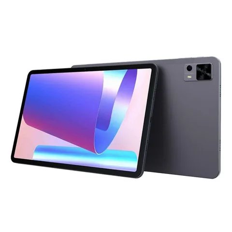
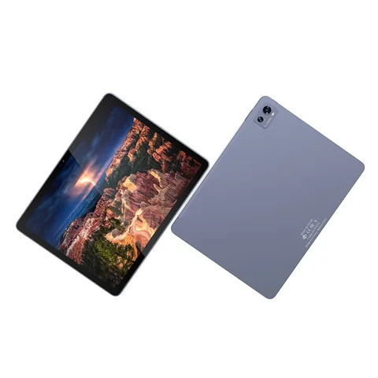

# BESTAR TEK blog image briefs

Use the existing BESTAR TEK product images below. The WebP derivatives resize the full original frame to 320 × 320, 480 × 480 and 800 × 800 pixels with no crop, generated overlays, or hardware alterations. Confirm the site owner's reuse rights before distributing the images to a third party.

## Android Kiosk Tablets: App Preload, Lock Task Mode and MDM

- Product photo: BESTAR TEK 11.97-inch Android tablet. [Original JPEG](https://bestartek.com/wp-content/uploads/2025/11/11.97-tablet-PC-BESTAR-TEK-1.jpg).
- Composition: Keep the whole tablet visible and retain the original background. In a two-column hero, put the headline and intro in HTML on the left, and the photo on the right. Stack below the introduction on mobile.
- Placement: Immediately after the introduction in reading order. Keep any kiosk policy comparison in the section below as an HTML table.
- English alt text: `BESTAR TEK 11.97-inch Android tablet`
- Caption: `Example tablet for discussing kiosk deployment requirements.` The image does not show a verified kiosk configuration.

```html

```

## How to Validate Android Tablet Firmware and OTA Updates Before Rollout

- Product photo: BESTAR TEK 13.4-inch Android 15 tablet. [Original JPEG](https://bestartek.com/wp-content/uploads/2025/11/13.4-inches-tablet.jpg).
- Composition: Place the intact square image beside a separate HTML firmware version matrix on wide layouts. On mobile, display the image above the matrix. Keep all firmware labels and versions out of the image.
- Placement: Immediately before the pilot update matrix, below the fold.
- English alt text: `BESTAR TEK 13.4-inch Android 15 tablet`
- Caption: `Example tablet shown for context. OTA capability and recovery behavior depend on the selected firmware and deployment configuration.`

```html

```

Set image CSS to `max-width: 100%; height: auto; display: block`. The sizes examples assume a figure at most 400 CSS pixels wide on desktop and 20-pixel page gutters on mobile. Recheck sizes against the final blog layout. Reserve high fetch priority for the above-the-fold image if it is the primary LCP candidate. Use lazy loading for the below-the-fold image.

No generated images are needed for the current layouts. If a future article requires an explanatory illustration beyond the live HTML diagram, use only an explicitly labelled conceptual figure, with all labels repeated as HTML:

> Illustrative concept only: clean editorial diagram on a neutral background, three abstract icons representing a written project brief, device configuration and acceptance testing. No physical product render, real interface, logo, port, certification badge, text, or implied customer deployment. Leave generous space between icons for separate HTML labels.
